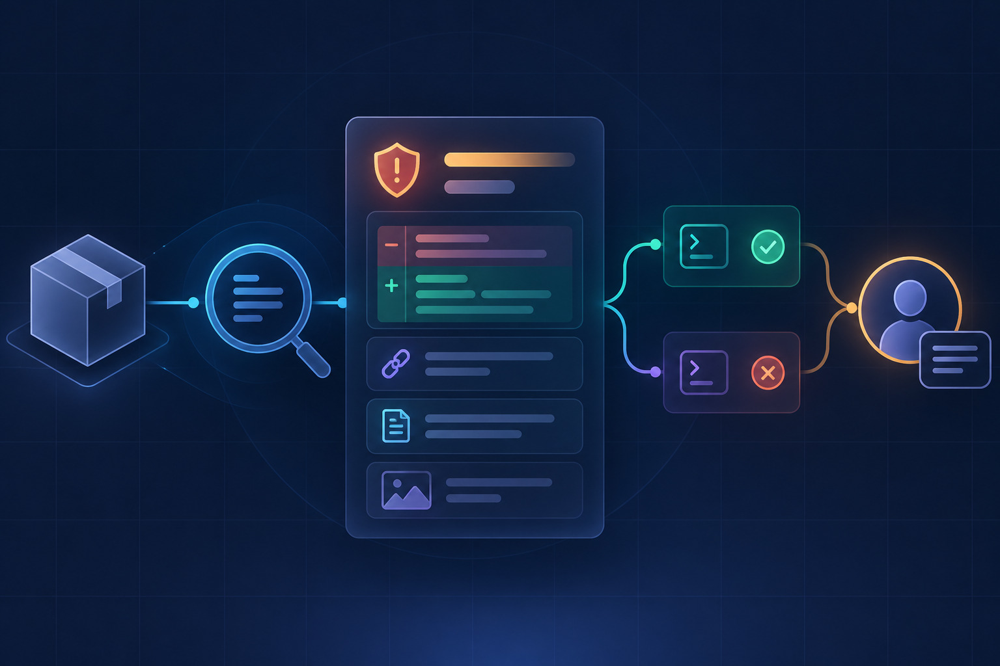
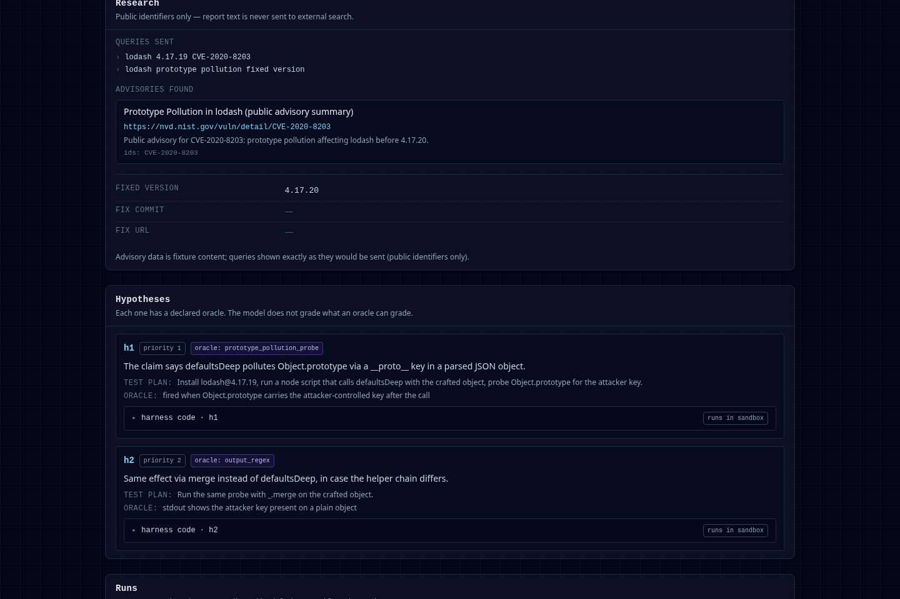

# Mimi

**Evidence-first npm vulnerability triage for open-source maintainers.**

Mimi turns a vulnerability report into a reviewable dossier: what the package source supports, which checks ran, what they found, and what a maintainer could say next. It is designed to test a report against the affected package version, then give the maintainer the final say. Mimi does not auto-close reports.



Mimi is a project for the **Nebius × NVIDIA Global AI Hackathon 2026**, Track 2: Best Apps and Agents. It combines Nebius Token Factory inference, NVIDIA Nemotron models, Tavily advisory research, and Nebius Sandboxes as the boundary for untrusted proof-of-concept code.

## Demo status

The **[hosted read-only demo](https://zalkabsi.github.io/Mimi/)** is live and needs no account, API key, or provider credits. It opens a fixed sample dossier for exploring the interface; it is not the result of a live vulnerability analysis. See the [deployment guide](docs/deployment.md) for hosting details.

### Replay screenshot

This capture shows recorded advisory research and declared test hypotheses from the read-only replay. The displayed evidence is fixed fixture data, not live analysis.



The current Token Factory Sandboxes endpoint returned HTTP 200 on a read-only access
check, with all six permissions enabled. On 2026-10-17, a safe no-op run using node:20 and
is-number@7.0.0 also built and executed. Mimi confirmed its child network namespace, and
an outbound TCP connection attempt was blocked with ENETUNREACH. On 2026-10-18, live E1–E4
pipeline evaluations completed; they are small exploratory runs, not evidence of broad
accuracy. E1 had 0/11 fixed-version-confirmed reproductions. E2 produced no useful separation
between real and fabricated reports. E4's path-escape read check was inconclusive, and
provider-level hostile-code isolation remains unverified. See
[the evaluation results](docs/evaluation-results.md) for sample sizes and intervals.
No general reproduction or slop-discrimination claim is made; Sandbox billing conversion
and live hosted-demo behavior are also unverified.

For live analysis, report text is sent to Nebius Token Factory for inference. Tavily receives only public identifiers, not report prose or PoC code. Generated PoC code is sent to Nebius Sandboxes when live execution is enabled.

## Run the sample locally

```bash
cd frontend
npm ci
VITE_USE_MOCK=1 npm run dev
```

Open the local URL printed by Vite and select the sample report. Replay mode makes no provider calls, hides the access-key field, and disables report submissions. On Windows PowerShell, set `$env:VITE_USE_MOCK = "1"` before running `npm run dev`.

## How Mimi works

1. **Ground the report.** Nemotron Nano structures the claim. Deterministic checks compare cited files, symbols, and versions with the affected package source. Source grounding is supporting evidence; it cannot reject a report on its own.
2. **Research public advisories.** Tavily searches with public identifiers such as package names, versions, CVE IDs, and GHSA IDs. Report prose and proof-of-concept code are excluded from search queries.
3. **Plan bounded checks.** Nemotron proposes test hypotheses with predeclared deterministic oracles. The backend validates each operation against an allowlist; the model cannot issue arbitrary tool calls.
4. **Run in an isolated boundary.** Mimi builds the affected package and is designed to
   run each hypothesis in a separate Nebius Sandbox. A safe no-op smoke confirmed Mimi's
   child network namespace and observed an outbound TCP attempt blocked with ENETUNREACH.
   This verifies the basic path for that harmless run, not hostile PoC containment or the
   provider's microVM boundary. Runs have time and output limits, and provider credentials
   are not sent into a sandbox.
5. **Return a dossier.** Deterministic tier logic reports the verdict, coverage, commands, outputs, and a draft maintainer reply.

Verdicts are **Confirmed**, **Likely**, **Needs human**, and **Contradicted**. A negative verdict requires at least three conclusive hypotheses across at least two distinct configurations, with coverage shown. A single configuration remains **Needs human**. Failed builds and incomplete runs cannot become a clean negative. Every report remains under maintainer control.

## Run the application locally

The read-only sample API can run without provider credentials. Live submissions require a Nebius Token Factory key, a Nebius project with Sandboxes permissions, and optionally a Tavily key. Copy `.env.example` to `.env` and keep credentials out of source control.

Prerequisites: Python 3.12 or 3.13, Node.js 18 or 20+, and npm.

Start the backend from the repository root:

```bash
python3.12 -m venv .venv
source .venv/bin/activate
python -m pip install -e ./backend
uvicorn mimi.api:app --app-dir backend --reload --port 8000
```

In another terminal, start the frontend:

```bash
cd frontend
npm ci
npm run dev
```

The frontend uses `http://localhost:8000` by default. Without `MIMI_JUDGE_KEY`, the API serves only the bundled read-only dossier. For live report access, set the same judge key in the backend environment and enter it in the UI. The UI keeps it in `sessionStorage` for the current tab; **Clear key** removes it. Anyone holding this shared key can read every report on that deployment, so use only public sample reports on a shared demo. The database defaults to `mimi.db`; set `MIMI_DB_PATH` to use another location.

### CLI

After installing the backend, the CLI can analyze a report file and write a JSON dossier:

```bash
mimi report --package minimist@1.2.5 \
  --file backend/mimi/data/sample_report.md \
  --out dossier.json
```

This command uses live providers and Sandboxes. `mimi whoami` checks Sandbox access without printing credentials. `mimi demo` runs the bundled public CVE-2021-44906 sample through the live pipeline; it is not a no-credentials demo.

## Configuration

| Variable | Purpose |
| --- | --- |
| `NEBIUS_API_KEY` | Token Factory inference and Sandboxes access. Store it in an environment secret or ignored `.env` file. |
| `NEBIUS_PROJECT_ID` | Project sent as the Sandboxes `Project` header; the token also needs the required grants. |
| `TAVILY_API_KEY` | Optional live advisory research. Without it, the dossier records that research was skipped. |
| `MIMI_JUDGE_KEY` | Protects API submissions and live report reads through the `X-Mimi-Key` header. |
| `MIMI_DB_PATH` | SQLite database path; defaults to `mimi.db` in the process working directory. |
| `MIMI_CORS_ORIGINS` | Comma-separated browser origins allowed to call the API. Defaults to the local Vite URLs. |
| `MIMI_FORCE_MODEL` | Optional evaluation override: `nano`, `super`, or `ultra`. |
| `VITE_API_BASE` | API URL used by the frontend; defaults to `http://localhost:8000`. |
| `VITE_USE_MOCK` | Set to `1` to browse the bundled read-only sample without the backend. |

## Evaluation and limits

The repository includes an evaluation harness with 27 cases. Cases that cannot run are recorded as `not_run`; missing results are never estimated. See [the evaluation guide](evals/README.md) for suites and commands and [the 2026-10-18 results](docs/evaluation-results.md) for the completed exploratory runs. The corpus includes public npm vulnerability cases and clearly labelled synthetic reports. Synthetic cases are not real reports, and results do not generalize to C/C++ memory-safety vulnerabilities. The current product scope is npm.

The October 15, 2026 probe used the old api.sandbox.nebius.ai base URL and returned HTTP
403. Nebius moved ConTree into Token Factory Sandboxes in May 2026. The current endpoint
returned HTTP 200 with all six permissions on October 17. A safe no-op run then built
node:20 with is-number@7.0.0, executed successfully, confirmed Mimi's child network
namespace, and observed a TCP connection attempt blocked with ENETUNREACH. Exploratory
E1–E4 live runs followed on October 18; see [their results](docs/evaluation-results.md).
No fixed-version-confirmed reproduction occurred in the 11-case E1 sample, and E2 did not
distinguish real from fabricated reports. The E4 path-read check was inconclusive. This
does not establish reliable triage or provider-level isolation. Sandbox cost is recorded
only in raw Contree units; currency conversion is unknown.

## Project links

- [Architecture and evaluation protocol](docs/02-architecture.md)
- [Architecture diagram](docs/assets/architecture.svg)
- [Deployment guide](docs/deployment.md)
- [Constraints and open items](docs/00-constraints-and-open-items.md)
- [Product feedback log](docs/feedback-log.md)
- [Hackathon submission copy and demo script](docs/submission-kit.md)
- [Build log](CHANGELOG.md)
- [Apache-2.0 license](LICENSE)

## Security

Do not run reporter-supplied proof-of-concept code on the application host. Mimi is
designed to execute it inside Nebius Sandboxes. A safe no-op smoke confirmed Mimi's
child network namespace and observed an outbound TCP connection attempt blocked with
ENETUNREACH, but this does not establish provider-level microVM security against hostile
PoC code. Live public-case evaluations ran; they did not confirm a fixed-version
reproduction in the 11-case E1 sample. Broader exploit safety and a provider-boundary
security review remain incomplete. Package install and
setup scripts also run inside the sandbox as its unprivileged `node` account.
Probe-style observations use state in the same writable sandbox VM as the PoC and are
not tamper-proof against hostile code; the dossier flags this limitation. Review the
[architecture and trust boundaries](docs/02-architecture.md) before exposing a live
deployment. Never place provider credentials or private report data in a sandbox.
