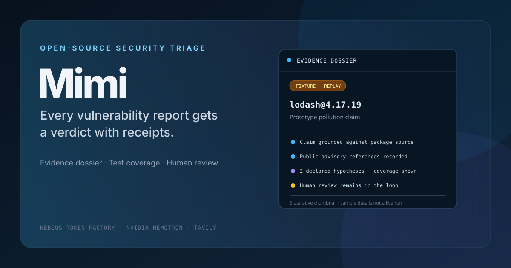

# Mimi

**Every vulnerability report gets a verdict with receipts.**



Mimi helps open-source maintainers triage vulnerability reports. Its pipeline is designed to test a report's claim against the exact affected package version in a Nebius Token Factory Sandbox and return an evidence dossier: what was proven, what was contradicted, and how much was tested. Mimi never auto-closes a report; the maintainer decides.

Mimi is built for the Nebius × NVIDIA Global AI Hackathon 2026 (Track 2: Best Apps and Agents). It uses Nebius Token Factory inference with NVIDIA Nemotron 3 Nano, Super, and Ultra, and Tavily for public-advisory research. Sandboxes is the configured boundary for untrusted proof-of-concept execution, but current credentials receive HTTP 403; the live execution path and evaluation results are not verified.

## Try the read-only demo

The frontend includes a clearly labelled fixture dossier. It needs no backend, credentials, or provider credits. Replay mode makes no provider calls, does not show an access-key field, and does not accept submissions. The dossier is sample UI data and is not a measured Mimi run.

```bash
cd frontend
npm ci
VITE_USE_MOCK=1 npm run dev
```

Open the local URL printed by Vite. The inbox links to the sample dossier; submissions are disabled in this mode. To use PowerShell, run `$env:VITE_USE_MOCK = "1"` before `npm run dev`.

You can also browse the same read-only sample through the FastAPI backend: install the backend as described below, start `uvicorn`, and run the frontend without `VITE_USE_MOCK`. The API includes the bundled demo report and its recorded timeline even when no provider credentials are configured; submissions and live report reads require `MIMI_JUDGE_KEY`.

## Run Mimi locally

Live report triage needs a Nebius Token Factory key, a Nebius project ID with Sandboxes permissions, and (optionally) a Tavily key. Store credentials in environment variables or the ignored root `.env` file; never paste keys into source control or chat. Copy `.env.example` to `.env` and fill in the values.

Prerequisites: Python 3.12 or 3.13, Node.js 18 or 20+, and npm.

Install the backend and start the API from the repository root:

```bash
python3.12 -m venv .venv
source .venv/bin/activate
python -m pip install -e ./backend
uvicorn mimi.api:app --app-dir backend --reload --port 8000
```

On Windows PowerShell, create the environment with `py -3.12 -m venv .venv` and activate with `.venv\Scripts\Activate.ps1`. If using Python 3.13, substitute its executable when creating the environment.

In a second terminal, start the frontend:

```bash
cd frontend
npm ci
npm run dev
```

The UI uses `http://localhost:8000` by default. Live submissions and access to real report contents require the configured `MIMI_JUDGE_KEY`. Without it, the API exposes only the bundled read-only dossier. The UI keeps the entered key in `sessionStorage` for the current tab so it can load protected reports; use **Clear key** to remove it. This is a shared judge credential: anyone who has it can read all reports on that deployment, so use public sample reports only on a shared demo. For local development, set the same environment variable before starting the backend. The database defaults to `mimi.db` in the current directory; set `MIMI_DB_PATH` to change it.

### CLI

After installing the backend, run a report from a file and save the dossier as JSON:

```bash
mimi report --package minimist@1.2.5 \
  --file backend/mimi/data/sample_report.md \
  --out dossier.json
```

The command uses live providers and Sandboxes. `mimi whoami` checks Sandboxes access without printing credentials. `mimi demo` runs the bundled, already-public CVE-2021-44906 sample through the live pipeline; it is not a no-credentials demo. Use the read-only frontend fixture above when you only want to explore the interface.

## How it works

1. **Extract and ground:** Nemotron Nano structures the claim; deterministic checks compare cited files, symbols, and versions against the package source. Grounding is evidence only and can never reject a report by itself.
2. **Research:** Tavily searches using public identifiers such as package, version, and CVE/GHSA IDs. Report prose and PoC code are checked out of the query path.
3. **Form hypotheses:** Nemotron Ultra proposes bounded test plans with predeclared deterministic oracles. The backend executes only validated, allowlisted operations; the model does not issue arbitrary tool calls.
4. **Build and execute:** Mimi builds the affected package once, then forks isolated Sandboxes for each hypothesis. PoC execution has time and output limits; no provider credentials are put in a sandbox.
5. **Differential and dossier:** Mimi repeats fired hypotheses against a researched fixed version when available. Deterministic tier logic produces the verdict, coverage statement, exact commands, run outputs, and a draft maintainer reply.

The tiers are **Confirmed**, **Likely**, **Needs human**, and **Contradicted**. A negative verdict requires executed, conclusive checks and reports the hypotheses and configurations covered. Failed builds, incomplete runs, and unknown fixed-version results cannot become a clean negative. No tier triggers an external action.

## Configuration

| Variable | Required for | Notes |
| --- | --- | --- |
| `NEBIUS_API_KEY` | Token Factory inference and Sandboxes | Keep it in an environment secret or ignored `.env`. |
| `NEBIUS_PROJECT_ID` | Sandboxes | The project ID is sent as the `Project` header. The token also needs the Sandboxes grants. |
| `TAVILY_API_KEY` | Live advisory research | Optional; without it, the dossier records that research was skipped. |
| `MIMI_JUDGE_KEY` | API submissions and live report reads | Requests must include this value in `X-Mimi-Key`; without it, the API serves only the bundled read-only dossier. |
| `MIMI_DB_PATH` | SQLite location | Defaults to `mimi.db` in the process working directory. |
| `MIMI_CORS_ORIGINS` | Browser access to the API | Comma-separated allowed origins; defaults to the two local Vite URLs. Set the deployed frontend origin when hosting. |
| `MIMI_FORCE_MODEL` | Evaluation ablations | Optional `nano`, `super`, or `ultra` override. |
| `VITE_API_BASE` | Frontend | Defaults to `http://localhost:8000`. Set it in `frontend/.env` for another backend URL. |
| `VITE_USE_MOCK` | Frontend fixture mode | Set to `1` to browse the bundled read-only fixture without a backend. |

## Current status and limits

The repository contains the FastAPI backend and CLI, React inbox and dossier UI, deterministic oracle and tier logic, SQLite event storage, and an evaluation harness with 27 cases. The fixture UI can be explored locally without credentials. Live runs require the external provider credentials and permissions described above.

On **October 15, 2026**, the Sandboxes `whoami` probe returned HTTP 403 for both supported endpoint paths in the current build environment. This does not establish whether the token lacks a specific grant or whether access is otherwise unavailable; real sandbox execution and the execution-dependent evaluation suites remain blocked until the endpoint returns usable permissions. The fail-closed child user/network namespace guard is implemented but unverified in a live sandbox. No reproduction rate, model-routing result, sandbox cost, or live demo result is claimed here. Check `docs/00-constraints-and-open-items.md` and `CHANGELOG.md` for the latest recorded status.

The evaluation corpus includes public npm vulnerability cases and explicitly labelled synthetic fabricated reports. Synthetic cases are not real slop reports; results do not generalize to C/C++ memory-safety vulnerabilities. The code supports the npm MVP only.

## Evaluation

The harness records cases that cannot run as `not_run`; it never fills missing results with estimates. See [`evals/README.md`](evals/README.md) for the suites, required credentials, and commands. Results are written to the ignored `evals/out/` directory.

## Project notes

- [Architecture and evaluation protocol](docs/02-architecture.md)
- [Architecture diagram (SVG)](docs/assets/architecture.svg)
- [Deployment guide](docs/deployment.md)
- [Constraints and open items](docs/00-constraints-and-open-items.md)
- [Product feedback log](docs/feedback-log.md)
- [Hackathon submission copy and demo script](docs/submission-kit.md)
- [Illustrative submission thumbnail](docs/assets/mimi-thumbnail.svg)
- [Build log](CHANGELOG.md)
- [License](LICENSE) — Apache-2.0

## Security

Do not run reporter-supplied PoC code on the application host. Mimi is designed to execute it only inside Token Factory Sandboxes. Until Sandboxes access and per-run network isolation are verified, treat live execution of untrusted reports as blocked. Use public reports for demos and evaluations, and do not put credentials or private report data in a sandbox. Review `docs/02-architecture.md` for the trust boundaries and known limitations before exposing a live deployment.
