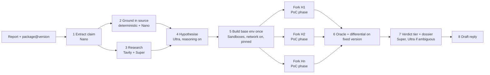

# Assay: architecture and build plan (Phases 5-7, draft)

Status: **draft for review**. Working title "Assay" (name availability and trademarks not checked). Assumptions marked **VERIFY** are spikes for week 1; see `00-constraints-and-open-items.md`.

## One-line pitch

Every vulnerability report gets a verdict with receipts: Assay reproduces the claim in isolated sandboxes at the exact affected version and tells the maintainer what is proven, what is contradicted, and how hard it looked.

## Principles

1. **Never auto-close.** Output is an evidence dossier and a triage tier. The maintainer decides.
2. **Prove before you doubt.** The pipeline first tries to make the reporter right. A "no" is only issued as quantified coverage.
3. **Deterministic oracles first.** The LLM proposes hypotheses and interprets ambiguous output; it does not grade a reproduction that a deterministic check can grade.
4. **Smallest architecture that works.** One backend, one database file, no queue service, no vector store.
5. **Every claim in the demo is measured.** Cost, latency and accuracy come from logged runs.

## Flow

## Stages

| # | Stage | Model / tool | Output | Notes |
|---|---|---|---|---|
| 1 | Extract claim | Nemotron Nano, JSON schema | `{package, versions, vuln_class, cited_symbols[], poc, expected_effect}` | Cheap, high volume. Schema-validated; retry once on invalid. |
| 2 | Ground in source | Deterministic (git checkout at version, grep/AST for cited files and symbols) + Nano summary | `grounding_evidence[]` | **Evidence only. Never a sole basis for rejection** (SlopCheck contradicts 29.4% of confirmed vulns, and 90% of its contradictions are wrong). It ranks hypotheses. |
| 3 | Research | Tavily search, Super to synthesise | known advisories, duplicates, fixed version / fix commit | Query builder uses public identifiers only; a redaction test enforces it. |
| 4 | Hypothesise | Nemotron Ultra, reasoning on, tool calling | ranked hypotheses, each with test plan and a **predeclared oracle** | Oracle types: exit code / signal, marker file, output regex, timing threshold for ReDoS, prototype-pollution probe, path traversal file read. |
| 5 | Build once | Sandboxes: run install/build with `disposable=false`, keep the result image UUID | base image | Network on for install only. |
| 6 | Fork per hypothesis | Sandboxes: each PoC run starts from the base image UUID (independent fork), capped concurrency (<= 50, start with 8) | stdout/stderr/exit/timing/`cost` per run | PoC phase wrapped so it has no network (**VERIFY** `unshare -n`), hard timeout, output cap. |
| 7 | Differential | Same oracle on the fixed version from stage 3 | flips or not | Confirms the oracle measures the bug, not an artifact. |
| 8 | Verdict + dossier | Super; Ultra only when oracles disagree or are inconclusive | tier + coverage statement + exact commands | Tiers below. |
| 9 | Draft reply | Super | maintainer-ready response | Asks for specific missing info, or acknowledges with repro steps. |

### Verdict tiers

| Tier | Meaning | Required evidence |
|---|---|---|
| **Confirmed** | Reproduced on affected version and not on fixed version | Oracle fired on affected, did not on fixed; commands and outputs attached |
| **Likely** | Oracle fired but no fixed-version differential (no fix yet, or fix unknown) | Oracle output attached |
| **Needs human** | Could not build, ambiguous output, or coverage too low to say | What was tried, why it stopped |
| **Contradicted** | Executed evidence against the claim | N hypotheses tested across K configurations, 0 triggered, plus grounding evidence (e.g. cited symbol absent at that version). States the coverage; never says "invalid" |

Coverage is a number the UI shows ("7 hypotheses, 3 configs, 0 triggered"), so a maintainer can judge how much to trust a Contradicted tier.

## Component design

| Layer | Choice | Reason |
|---|---|---|
| Backend | Python 3.12, FastAPI, asyncio tasks | `contree-sdk` is Python (sync and async). No Celery/Redis: a report is one async job with bounded concurrency. |
| Sandboxes | `contree-sdk` (async), image UUIDs as fork points | The core Nebius integration. |
| Inference | OpenAI-compatible client to Token Factory (**VERIFY** base URL and model IDs) | One thin `LLMClient` with per-stage model choice, retry, token and latency logging. |
| Frontend | Vite + React + Tailwind, SSE for live stage events | Polished inbox and timeline matter for the Design criterion. |
| Storage | SQLite (WAL) | Single file, trivial for judges to run, enough for this scale. |
| Auth | None for demo mode (seeded inbox, read-only, replayable). "Try your own" behind a simple access code with per-session budget cap | Judges must not pay or hit walls; the tool executes code, so unauthenticated free execution is off. |
| Memory / RAG | None | Not needed: research is live search, grounding is direct source access. Add nothing sophisticated for its own sake. |
| Observability | Structured JSON event per stage (model, tokens, latency, sandbox run ids, cost) stored in SQLite and shown in the UI timeline; the same data feeds the eval report | Cost and latency numbers in the video come from here. |
| Deployment | Frontend static host; backend on a small VM/PaaS; secrets in env | Hosting on Nebius AI Cloud is possible but adds nothing to the product, so it is not in scope unless credits and time allow. |

## Model routing

- Start with a static table (stage to model) and log everything.
- Ablations (see eval): all-Ultra, all-Super, routed. Report accuracy, cost per report and wall time. Reasoning budget is a separate knob (**VERIFY** it is exposed on Token Factory).
- Only claim routing benefits if the ablation shows them.

## Security model

- **Threat.** Reporter-supplied PoC may be hostile, and reports may contain prompt injection aimed at our own agent.
- Untrusted code runs only inside Sandboxes microVMs (own kernel per run). Never on the app host.
- No secrets, tokens or cloud credentials in any sandbox environment or image.
- PoC phase: no network (**VERIFY**); if not achievable, document as a known limitation and restrict the hosted demo to seeded cases.
- Timeouts, output truncation, per-report and per-session cost caps, allowlist of public git hosts and registries.
- Prompt injection: report text is data. Model outputs are parsed into a strict schema; commands executed come from a fixed command set (checkout, install, run-poc-with-oracle, git diff), not free-form strings from the report. The PoC file itself is executed but only in the sandbox.
- Privacy: report text goes to Token Factory (inference) and never to Tavily; the README documents the self-hosting option (own Nebius tenancy).
- Demo and eval use only vulnerabilities that are already public.

## Evaluation (protocol fixed before running)

Nothing below has been run. Numbers will be reported as measured, with sample sizes and intervals.

| Eval | Data | Question | Metrics | Baselines |
|---|---|---|---|---|
| E1 Reproduction | SecBench.js subset (stratified by 5 classes, size set by budget, target 60-100); input is the advisory-style description without the exploit | Does Assay reproduce real vulnerabilities? | reproduction rate with oracle, confirmed-with-differential rate, median wall time, cost per case | (a) single-shot Ultra writing a PoC, no sandbox feedback; (b) same agent, linear (no forks) |
| E1b Freshness | 20-30 recent advisories published after the model's cutoff, public PoC exists | Is E1 inflated by memorisation? | same as E1 | same |
| E2 Slop discrimination | real vulnerabilities reworded in report style, plus **synthetic fabricated** reports about real package versions (prompts published, labelled synthetic) | Does it wrongly reject real ones? Does it evidence fabricated ones? | **false-Contradicted rate on real (primary safety metric, with Wilson interval)**, share of fabricated reaching Contradicted with coverage, share routed to Needs human | grounding-only gate (replicates SlopCheck's failure mode) |
| E3 Routing | subset of E1/E2 | Does routing save cost without losing accuracy? | accuracy, cost, latency: all-Ultra vs routed | all-Ultra, all-Super |
| E4 Safety | scripted hostile PoCs (network call, fork bomb, huge output, path escape) and injected report text | Are limits enforced? | pass/fail per case | none |

Limits to state publicly: SecBench.js is npm only; synthetic slop is not real slop; results do not extend to C/C++ memory-safety reports; the curl 557-report set (SlopCheck) is used, if licensing allows, only to test the grounding stage and to illustrate why grounding cannot gate.

## Vertical slices (4 weeks; target submit Tue Oct 27)

| Week | Slice | Exit criterion |
|---|---|---|
| 1 (Sep 29 - Oct 5) | **Spikes + magic moment.** Token Factory call with tool calling and reasoning control; Sandboxes build-once and 5 parallel forks of a real npm vuln; `unshare -n` test; Tavily call. Then CLI: one report in, dossier JSON out | One real public npm vulnerability goes report to Confirmed with a fixed-version differential. Pivot-trigger review Oct 5 |
| 2 (Oct 6 - 12) | Full pipeline (grounding, research, hypotheses, oracles, tiers); eval harness v0 on 20 cases; minimal inbox and live timeline | E1 runs end to end on 20 cases; failure taxonomy started |
| 3 (Oct 13 - 19) | E1/E2/E3/E4 at scale; fix top failure modes; UI polish; PyPI support only if E1 is stable; deploy hosted demo | Numbers stable; demo URL public; hostile-PoC tests pass |
| 4 (Oct 20 - 26) | Feature freeze Oct 22. README, architecture diagram, license, Devpost text, screenshots, video, feedback notes | Everything submitted Oct 27; Oct 28-30 buffer only |

## Testing

- Unit: claim schema, redaction of Tavily queries, oracle checkers, tier logic.
- Recorded-LLM golden runs (deterministic, no credits) for CI.
- Opt-in integration suite against real Sandboxes and Token Factory (uses credits).
- Safety suite E4 in CI-optional mode.
- Run the hosted demo from a clean machine before submission (a judge-eye check, including with the test access code).

## How this maps to the judging criteria

| Criterion | What we show | Where it is weakest today |
|---|---|---|
| Technological implementation | Build-once fork-many sandboxes, deterministic oracles, model routing with ablation, safety suite | Environment builds vary; network isolation unverified |
| Design | Inbox, live timeline, dossier with exact commands and coverage, no dead ends ("Needs human" is a designed state) | Needs a real design pass in week 3 |
| Potential impact | Maintainer time per report (curl: 30 min to 3 h, several people), measured time and cost per report from our runs | We have no real-maintainer validation yet; seek 1-2 maintainer conversations and quote only what they actually say |
| Quality of idea | Negative-result coverage; evidence-not-verdict stance backed by the SlopCheck result | Neighbouring work exists (Elastic internal, HackerOne, SlopCheck); novelty is the combination and the measured rigor |

## Deliverables checklist (Phase 9, filled later)

README (12 required items), LICENSE (recommend Apache-2.0), `CHANGELOG.md`, architecture diagram (export of the flow above), Devpost description, screenshots, 3-minute script, demo recording plan, title and tagline, thumbnail, feedback notes (`docs/feedback-log.md`), deployment docs.
