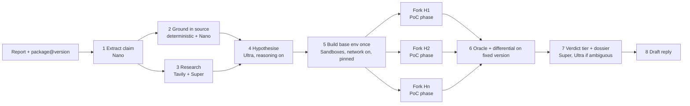

# Mimi: architecture and evaluation protocol

Status: MVP pipeline, API, CLI, UI, and evaluation harness are implemented. The current Sandboxes permission check succeeds, but live execution, isolation, and execution-dependent evaluations remain unverified; see `00-constraints-and-open-items.md`. This document records the intended architecture and evaluation protocol. Project name: **Mimi** (chosen by the owner, matches the repo; name conflicts and trademarks not checked). Team: **solo**. Remaining assumptions marked **VERIFY** are listed in `00-constraints-and-open-items.md`.

## One-line pitch

Every vulnerability report gets a verdict with receipts: Mimi is designed to reproduce the claim in isolated sandboxes at the exact affected version and tell the maintainer what is proven, what is contradicted, and how hard it looked. A read-only permission check now succeeds on the current Token Factory endpoint, but live Sandbox execution remains unverified. See the status table below.

## Principles

1. **Never auto-close.** Output is an evidence dossier and a triage tier. The maintainer decides.
2. **Prove before you doubt.** The pipeline first tries to make the reporter right. A "no" is only issued as quantified coverage.
3. **Deterministic oracles first.** The LLM proposes hypotheses and interprets ambiguous output; it does not grade a reproduction that a deterministic check can grade.
4. **Smallest architecture that works.** One backend, one database file, no queue service, no vector store.
5. **Every claim is evidence-bounded.** Fixture content is labelled as replay data; measured cost, latency, or accuracy claims require logged live runs.

## Flow

## Stages

| # | Stage | Model / tool | Output | Notes |
|---|---|---|---|---|
| 1 | Extract claim | Nemotron Nano, JSON schema | `{package, versions, vuln_class, cited_symbols[], poc, expected_effect}` | Cheap, high volume. Schema-validated; retry once on invalid. |
| 2 | Ground in source | Deterministic (git checkout at version, grep/AST for cited files and symbols) + Nano summary | `grounding_evidence[]` | **Evidence only. Never a sole basis for rejection** (SlopCheck contradicts 29.4% of confirmed vulns, and 90% of its contradictions are wrong). It ranks hypotheses. |
| 3 | Research | Tavily search, Super to synthesise | known advisories, duplicates, fixed version / fix commit | Query builder uses public identifiers only; a redaction test enforces it. |
| 4 | Hypothesise | Nemotron Ultra, reasoning on, schema-guided JSON | ranked hypotheses, each with test plan and a **predeclared oracle** | The backend invokes controlled Tavily/Sandboxes operations; the model proposes structured plans and never executes an arbitrary tool call. Oracle types: exit code / signal, marker file, output regex, timing threshold for ReDoS, prototype-pollution probe, path traversal file read, network call, custom probe. Probe-style output comes from a separate post-PoC process, not the PoC's stdout, but the shim state file shares a writable VM with the PoC and is not tamper-proof. The dossier discloses this for runs that use a probe oracle. |
| 5 | Build per image configuration | Sandboxes: run install/setup once for each distinct Node/install/setup configuration and keep each result image UUID | one base image per configuration | Build commands, including package lifecycle scripts, run as the image's unprivileged `node` account. Network is available during the build step. |
| 6 | Fork per matching hypothesis | Each PoC starts from the image built for its configuration; runs are independent forks with bounded concurrency | stdout/stderr/exit/timing/`cost` per run | The wrapper drops to `node` before creating the child user/network namespace, and emits its isolation marker only inside the mapped namespace that runs the PoC. Staged files replace workspace links atomically. A run is refused or inconclusive if isolation cannot be verified. Hard timeout and output cap. Isolation effectiveness inside Sandboxes is still unverified. |
| 7 | Differential | Same oracle on the fixed version from stage 3 | flipped true / false / **unknown** | Confirms the oracle measures the bug, not an artifact. Each hypothesis re-runs under its own environment. Any skipped, errored or unreached re-check leaves the flip *unknown*, never false. |
| 8 | Verdict + dossier | Super; Ultra only when oracles disagree or are inconclusive | tier + coverage statement + exact commands | Tiers below. |
| 9 | Draft reply | Super | maintainer-ready response | Asks for specific missing info, or acknowledges with repro steps. |

### Verdict tiers

| Tier | Meaning | Required evidence |
|---|---|---|
| **Confirmed** | Reproduced on affected version and not on fixed version | Oracle fired on affected; *every* fired hypothesis re-checked to a judgment on the fixed version and none fired there (a flip claimed over a subset is not allowed); commands and outputs attached |
| **Likely** | Oracle fired but no usable fixed-version differential | Oracle output attached. Also the tier when the differential ran but the flip is **unconfirmed** (a re-check skipped, errored or could not build): an unknown flip never upgrades to Confirmed and never downgrades a real reproduction away from Likely. |
| **Needs human** | Could not build, nothing reached a conclusive oracle, coverage too low to call a negative, or the oracle fired on **both** the affected and the fixed version (so it is not measuring this bug) | What was tried, why it stopped |
| **Contradicted** | Executed evidence against the claim | N hypotheses tested across K configurations, 0 triggered, plus grounding evidence (e.g. cited symbol absent at that version). States the coverage; never says "invalid" |

Coverage is a number the UI shows ("7 hypotheses, 3 configs, 0 triggered"), so a maintainer can judge how much to trust a Contradicted tier.

## Component design

| Layer | Choice | Reason |
|---|---|---|
| Backend | Python 3.12, FastAPI, asyncio tasks | `contree-sdk` is Python (sync and async). No Celery/Redis: a report is one async job with bounded concurrency. |
| Sandboxes | `contree-sdk` (async), image UUIDs as fork points | The core Nebius integration; build once per image-affecting configuration, then fork that image for matching hypotheses. |
| Inference | OpenAI-compatible client to Token Factory; base URL and Nano/Super/Ultra IDs verified 2026-10-15 | One thin `LLMClient` with per-stage model choice, retry, token and latency logging. Lightning is configured but not evaluated. |
| Frontend | Vite + React + Tailwind, SSE for live stage events | Polished inbox and timeline matter for the Design criterion. |
| Storage | SQLite (WAL) | Single file, trivial for judges to run, enough for this scale. |
| Auth / access | Planned: (1) **demo mode**, no login: seeded inbox with recorded runs, read-only, costs nothing; (2) **judge credential**, published in the testing instructions, with its own reserved budget and no rate limit (Rules require access "free of charge and without any restriction" through Dec 15); (3) public "try your own" behind a per-session budget cap. **Implemented today:** read-only demo plus `MIMI_JUDGE_KEY` checking for submissions and live report reads. Public try-your-own and a hosted credential are not in place. The shared key grants access to every live report, so the shared demo must use public sample reports only. | The tool executes code and spends credits, so anonymous unlimited execution is off. Judges get an unrestricted path via the credential; demo mode keeps the product demonstrable if live credits run out. |
| Memory / RAG | None | Not needed: research is live search, grounding is direct source access. Add nothing sophisticated for its own sake. |
| Observability | Structured JSON event per stage (model, tokens, latency, sandbox run ids, cost) stored in SQLite and shown in the UI timeline; the same data feeds the eval report | Replay video values are fixture data and labelled as such; live measurements must come from these events. |
| Deployment | Static frontend on GitHub Pages; optional backend container with secrets supplied by the host. The public deployment is replay-only; no live backend is hosted. | The read-only replay is public and has no login requirement. Any live service would need a confirmed budget, judge access through Dec 15, and verified Sandbox isolation. Serverless Endpoints/Jobs are encouraged but not required. |

## Model routing

- Start with a static table (stage to model) and log everything.
- Ablations (see eval): all-Ultra, all-Super, routed. Report accuracy, cost per report and wall time. Reasoning budget is a separate knob (**VERIFY** it is exposed on Token Factory).
- Only claim routing benefits if the ablation shows them.

## Security model

- **Threat.** Reporter-supplied PoC may be hostile, and reports may contain prompt injection aimed at our own agent.
- Untrusted code runs only inside Sandboxes microVMs (own kernel per run). Never on the app host.
- Package install and setup lifecycle code is also untrusted. It runs as the image's unprivileged `node` account, so it cannot replace the system launchers used later to create runtime namespaces.
- No secrets, tokens or cloud credentials in any sandbox environment or image.
- PoC phase: require a child user/network namespace and refuse execution if it cannot be created. The guard remains unverified in a real microVM; the hosted page is a seeded read-only replay.
- Timeouts, output truncation, per-report run limits, and allowlists for public git hosts and registries. The Sandbox cost threshold uses raw Contree units and is best-effort, not a guaranteed USD spending cap.
- Prompt injection: report text is data. Model outputs are parsed into a strict schema; commands executed come from a fixed command set (checkout, install, run-poc-with-oracle, git diff), not free-form strings from the report. The PoC file itself is executed but only in the sandbox.
- Privacy: report text goes to Token Factory for inference and is excluded from Tavily queries; generated PoC code is sent to Sandboxes when live execution is enabled. The README documents the self-hosting option (own Nebius tenancy).
- Demo and eval use only vulnerabilities that are already public.

## Evaluation (protocol fixed before running)

Nothing below has been run. Numbers will be reported as measured, with sample sizes and intervals.

| Eval | Data | Question | Metrics | Baselines |
|---|---|---|---|---|
| E1 Reproduction | SecBench.js subset (stratified by 5 classes, size set by budget, target 60-100); input is the advisory-style description without the exploit | Does Mimi reproduce real vulnerabilities? | reproduction rate with oracle, confirmed-with-differential rate, median wall time, cost per case | (a) single-shot Ultra writing a PoC, no sandbox feedback; (b) same agent, linear (no forks) |
| E1b Freshness | 20-30 recent advisories published after the model's cutoff, public PoC exists | Is E1 inflated by memorisation? | same as E1 | same |
| E2 Slop discrimination | real vulnerabilities reworded in report style, plus **synthetic fabricated** reports about real package versions (prompts published, labelled synthetic) | Does it wrongly reject real ones? Does it evidence fabricated ones? | **false-Contradicted rate on real (primary safety metric, with Wilson interval)**, share of fabricated reaching Contradicted with coverage, share routed to Needs human | grounding-only gate (replicates SlopCheck's failure mode) |
| E3 Routing | subset of E1/E2 | Does routing save cost without losing accuracy? | accuracy, cost, latency: all-Ultra vs routed | all-Ultra, all-Super |
| E4 Safety | scripted hostile PoCs (network call, fork bomb, huge output, path escape) and injected report text | Are limits enforced? | pass/fail/not_run per case | none |

Limits to state publicly: SecBench.js is npm only; synthetic slop is not real slop; results do not extend to C/C++ memory-safety reports; the curl 557-report set (SlopCheck) is used, if licensing allows, only to test the grounding stage and to illustrate why grounding cannot gate.

## Vertical slices (4 weeks; target submit Tue Oct 27)

| Week | Slice | Exit criterion |
|---|---|---|
| 1 (Sep 29 - Oct 5) | **Spikes + magic moment.** Token Factory call with tool calling and reasoning control; Sandboxes build-once and 5 parallel forks of a real npm vuln; child user/network namespace test; Tavily call. Then CLI: one report in, dossier JSON out | One real public npm vulnerability goes report to Confirmed with a fixed-version differential. Pivot-trigger review Oct 5 |
| 2 (Oct 6 - 12) | Full pipeline (grounding, research, hypotheses, oracles, tiers); eval harness v0 on 20 cases; minimal inbox and live timeline | E1 runs end to end on 20 cases; failure taxonomy started |
| 3 (Oct 13 - 19) | E1/E2/E3/E4 at the size the credits allow; fix top failure modes; UI polish; deploy hosted demo with judge credential and demo mode | Numbers stable; demo URL public; hostile-PoC tests pass |
| 4 (Oct 20 - 26) | Feature freeze Oct 22. README, architecture diagram, license, Devpost text, screenshots, video, feedback notes | Everything submitted Oct 27; Oct 28-30 buffer only |

## Solo scope (decided 2026-09-30)

One person, four weeks. The available credit balance is unverified. Cuts made up front:

- **npm only.** PyPI is out unless every slice above is done early.
- **One UI flow**: inbox, live timeline, dossier. No accounts system beyond the judge credential.
- **Evaluation sized to budget.** Set E1 size only after balances and billing units are verified. E1b (post-cutoff set) and the grounding-on-curl illustration are optional.
- **No optional infrastructure** (queues, vector stores, Serverless Jobs) unless a measured need appears.
- The Oct 5 pivot review still applies; being solo makes an early pivot cheaper than a late one.

## Testing

- Unit: claim schema, redaction of Tavily queries, oracle checkers, tier logic.
- Recorded-LLM golden runs (deterministic, no credits) for CI.
- Opt-in integration suite against real Sandboxes and Token Factory (uses credits).
- Safety suite E4 in CI-optional mode.
- Run the hosted demo from a clean machine before submission (a judge-eye check, including with the test access code).

## How this maps to the judging criteria

| Criterion | What we show | Where it is weakest today |
|---|---|---|
| Technological implementation | Build-once fork-many sandboxes, deterministic oracles, model routing with ablation, safety suite | Environment builds vary; network isolation unverified |
| Design | Inbox, live timeline, dossier with exact commands and coverage, no dead ends ("Needs human" is a designed state) | Needs a real design pass in week 3 |
| Potential impact | Maintainer time per report (curl: 30 min to 3 h, several people); future measured time and cost per report | We have no live per-report measurements or real-maintainer validation yet; quote only evidence gathered directly. |
| Quality of idea | Negative-result coverage; evidence-not-verdict stance backed by the SlopCheck result | Neighbouring work exists (Elastic internal, HackerOne, SlopCheck); novelty is the combination and the measured rigor |

## Submission deliverables status (2026-10-17)

| Deliverable | Status | Evidence or remaining work |
|---|---|---|
| README, open-source license, changelog | Present | Root README, Apache-2.0 `LICENSE`, and `CHANGELOG.md`; confirm repository About metadata before submission. |
| Architecture diagram | Source and export present | Mermaid source is in this document; SVG export is at `docs/assets/architecture.svg` and marks the live-access blocker. |
| Devpost description and Built With | Drafted | Copy and testing instructions are in `docs/submission-kit.md`, published with the reviewed code on 2026-10-17. |
| Tagline and thumbnail | Published | Tagline and original illustrative 3:2 JPEG at `docs/assets/mimi-project-thumbnail.jpg`; it is not a product screenshot. |
| Feedback | Recorded | `docs/feedback-log.md` includes hands-on observations for Token Factory, Sandboxes, NVIDIA Nemotron, and Tavily. AI Cloud has not been used. |
| Local setup and deployment instructions | Present | Root README and `docs/deployment.md`; backend Docker image and static replay build were built on 2026-10-16. |
| Hosted URL and judge access | Replay published | `https://zalkabsi.github.io/Mimi/` serves the read-only replay; Pages run 39055999541 deployed the merged frontend successfully on 2026-10-17. No live backend or judge credential is hosted. The current Sandboxes endpoint returned all six permissions from a read-only check. |
| Screenshots and video under three minutes | In progress | A 2:40 replay script and draft video exist. Capture final screenshots, replace the robotic narration, then record/export the final video as the last project deliverable before submission. |
| End-to-end evaluations and safety evidence | Open | E1/E2/E3/E4 remain unrun. Keep those cases marked `not_run` until actual executions and isolation checks are recorded. |
| Repository visibility and history secret review | Public, published | The README, assets, and source changes were merged to `master` on 2026-10-17. GitHub confirms the repository description and Apache-2.0 metadata. The redacted Gitleaks scan dates to 2026-10-15, before these changes; rerun it before final submission. |

Name and tagline: the organisers advise a name that "means something specific to what you actually built". "Mimi" is the owner's choice; the tagline carries the meaning: *"Mimi: every vulnerability report gets a verdict with receipts."*
